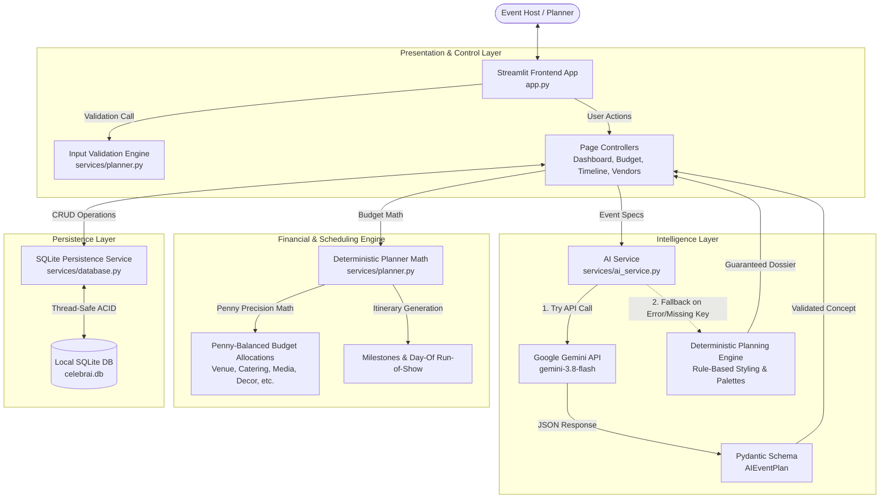

# ✨ CelebrAI — AI-Powered Celebration & Event Planner

> **PromptWars Virtual Challenge 5 — Celebration & Event Planner Category**
> *Where Bespoke Celebration Aesthetics Meet Deterministic Financial Precision.*

[](https://www.python.org/)
[](https://streamlit.io/)
[](https://aistudio.google.com/)
[](tests/)
[](https://github.com/Yemmmyc/celebrai)

---

## 📖 Table of Contents

1. [Project Overview & Problem Statement](#project-overview--problem-statement)
2. [Challenge Context (PromptWars Challenge 5)](#challenge-context-promptwars-challenge-5)
3. [Implemented Features](#implemented-features)
4. [User Interface & Screenshots](#user-interface--screenshots)
5. [Technology Stack & Architecture](#technology-stack--architecture)
6. [How It Works (End-to-End Workflow)](#how-it-works-end-to-end-workflow)
7. [Repository Structure](#repository-structure)
8. [Prerequisites](#prerequisites)
9. [Local Installation & Startup](#local-installation--startup)
10. [Environment Variables & Configuration](#environment-variables--configuration)
11. [AI Integration & Dual-Mode Engine](#ai-integration--dual-mode-engine)
12. [Financial Precision & Multi-Currency Handling](#financial-precision--multi-currency-handling)
13. [Database & Persistence Model](#database--persistence-model)
14. [Testing & Quality Assurance](#testing--quality-assurance)
15. [Deployment Guide (Streamlit Community Cloud)](#deployment-guide-streamlit-community-cloud)
16. [Security, Privacy & Repository Hygiene](#security-privacy--repository-hygiene)
17. [Confirmed Limitations & Future Roadmap](#confirmed-limitations--future-roadmap)
18. [Troubleshooting Guide](#troubleshooting-guide)
19. [Contributing Guidelines](#contributing-guidelines)
20. [License & Acknowledgements](#license--acknowledgements)
21. [Hackathon Submission Checklist](#hackathon-submission-checklist)

---

## 🎯 Project Overview & Problem Statement

### The Problem
Planning memorable celebrations—weddings, milestone birthdays, galas, and dinner parties—is fraught with friction. Event hosts and coordinators must navigate two conflicting disciplines:
- **Unconstrained Creative Vision**: Brainstorming evocative themes, cohesive color palettes, atmospheric decor, customized culinary menus, and guest activities.
- **Strict Operational Execution**: Balancing rigid budgets down to the penny, preventing unexpected vendor overruns, and coordinating intricate day-of schedules.

Traditional planning tools fail by doing either too little or too much: static spreadsheets lack creative inspiration, while generic AI chatbots hallucinate arithmetic, miscalculate line items, and mix foreign currencies indiscriminately.

### The CelebrAI Solution
**CelebrAI** is an intelligent, full-lifecycle celebration and event planning application built with **Streamlit**, **Python**, and **Google Gemini**. CelebrAI introduces an architectural boundary:
1. **Google Gemini** acts as the *Creative Event Director*, generating bespoke design concepts, mood narratives, color schemes, culinary highlights, and pro-tips validated against rigorous Pydantic schemas.
2. **Deterministic Python Algorithms** act as the *Financial Controller*, calculating penny-precision budget allocations, day-of run-of-show itineraries, and vendor rosters. **Budget arithmetic is never delegated to AI.**
3. **Local SQLite Persistence** provides thread-safe, transactional record-keeping for local celebration records.

---

## 🏆 Challenge Context (PromptWars Challenge 5)

CelebrAI was developed specifically for **PromptWars Virtual Challenge 5** under the **Celebration & Event Planner** category.

The challenge task asks builders to create software that eases celebration orchestration through generative AI. CelebrAI directly addresses this by providing:
- **Intelligent Ideation**: Personalized concepts tailored to the host's event category, location, guest size, and vibe preferences.
- **Deterministic Fallback Planning**: A built-in rule-based planning engine that maintains core celebration planning functionality when Google Gemini is unconfigured or unavailable, subject to the local application runtime functioning normally.
- **Budget Integrity**: Currency-segregated allocations across 4 international currencies (`USD`, `NGN`, `GBP`, `EUR`) preventing cross-currency contamination.
- **End-to-End Operational Tooling**: Interactive vendor procurement checklists, milestone schedules, and day-of minute-by-minute run-of-show tracking.

> [!NOTE]
> This project is an independent hackathon entry submitted to PromptWars Virtual Challenge 5. No official competition award, ranking, or judging endorsement is claimed.

---

## ✨ Implemented Features

Every feature listed below is verified and implemented in the active codebase:

### 1. Executive Dashboard (`page_dashboard`)
- **Portfolio KPIs**: Real-time metric cards displaying Total Celebrations, Total Planned Budget, Total Committed Spend, Honored Guests, and Next Celebration countdown.
- **Upcoming Celebration Spotlight**: Hero card highlighting the next chronological event with date, location, guest count, budget, and theme badge.
- **Currency-Safe Budget Visualization**: Horizontal Altair bar chart breaking down budgets by event type. Groups budgets strictly by currency into isolated tabs (`USD`, `NGN`, `GBP`, `EUR`) to prevent nominal sum distortion.
- **Recent Celebrations Portfolio**: Data table displaying recent events with formatted budgets, guests, status, and currency codes.
- **Portfolio Onboarding State**: Clean empty state greeting new hosts when no celebrations are saved.

### 2. Bespoke Celebration Creator (`page_create_event`)
- **8 Event Categories**: Full support for Weddings, Birthdays, Corporate Galas, Anniversaries, Baby Showers, Dinner Parties, Holiday Parties, and Custom celebrations.
- **Multi-Currency Selection**: Native support for US Dollar (`$ USD`), Nigerian Naira (`₦ NGN`), British Pound (`£ GBP`), and Euro (`€ EUR`).
- **Comprehensive Specifications**: Configurable event date, guest count, location/venue, total budget, desired theme vibe, and host notes.
- **Strict Deterministic Validation**: Pre-generation validation checking non-empty names/venues, positive guest counts, valid ISO `YYYY-MM-DD` dates, and supported currencies before executing any AI calls.

### 3. AI-Powered Creative Planning & Styling Engine
- **Structured Schema Generation**: Calls Google Gemini (`gemini-3.8-flash`) requesting structured JSON mapped directly to the `AIEventPlan` Pydantic model.
- **Theme Concept & Mood Description**: Evocative 2-3 sentence overview setting lighting, ambiance, and emotional tone.
- **4-Swatch Palette**: Curated color schemes with descriptive hex tones.
- **Decor Highlights**: Signature tactile staging concepts (centerpieces, backdrop ideas, ambient lighting).
- **Culinary & Beverage Concepts**: Welcome signature cocktails, artisanal hors d'oeuvres, and dessert station ideas.
- **Interactive Entertainment**: Guest engagement ideas (bespoke perfume bars, audio guestbooks, vinyl sets).
- **Planner Pro-Tips**: Practical coordination advice tailored to the specific celebration specs.
- **Deterministic Offline Fallback**: If Gemini is unconfigured, times out, or returns a 503/429 error, CelebrAI seamlessly activates its built-in rule-based styling engine.

### 4. Financial Controller & Budget Planner (`page_budget_planner`)
- **7 Standardized Allocation Categories**:
  - Venue & Atmosphere (25%)
  - Catering & Mixology (35%)
  - Media & Photography (15%)
  - Decor & Floral Design (10%)
  - Music & Entertainment (8%)
  - Invitations & Print (3%)
  - Contingency Reserve (4%)
- **Penny-Precision Arithmetic**: Integer-cent rounding with remainder reconciliation into Catering ensuring that $\sum \text{allocated} = \text{budget}$ without math discrepancies.
- **Live Variance Tracking**: Real-time calculation of allocated targets vs. actual vendor invoices, with dynamic color-coded financial indicators.
- **Interactive Line-Item Invoicing**: Hosts can record actual vendor spend, notes, and invoice updates per line item.

### 5. Dynamic Milestones & Day-Of Run-of-Show (`page_timeline`)
- **Dual-Perspective Timeline**:
  - **Master Milestones Tab**: Tracks long-term preparation from 6+ months out down to 1 week out and the eve of celebration.
  - **Day-Of Run-of-Show Tab**: Minute-by-minute schedule covering vendor load-in, host arrival, guest reception, program highlights, and load-out.
- **Interactive Completion Toggles**: Clickable checkboxes that persist status changes directly to the database with visual progress tracking.

### 6. Vendor Roster & Procurement Checklist (`page_vendor_checklist`)
- **5 Standardized Vendor Specialties**: Caterer, Floral Stylist, Photographer, DJ/Band, and Venue Coordinator.
- **Procurement Workflow**: Stage transitions across `Needed`, `Researching`, `Contacted`, `Booked`, and `Paid`.
- **Financial Alignment**: Side-by-side comparison of estimated allocations vs actual contractual spend.
- **Direct Vendor Card Updates**: In-place status toggles and actual cost tracking.

### 7. Portfolio Management & Inspection (`page_my_events`)
- **Event Filtering**: Filter portfolio by category and status (`Planning`, `Confirmed`, `Completed`).
- **Deep Event Dossier**: Expandable accordion revealing the full Gemini creative plan, color palette badges, decor concepts, culinary ideas, and planner tips.
- **Status Updates & Cascading Deletion**: Change planning stage or remove celebrations with full database cascade.

---

## 🖼️ User Interface & Screenshots

CelebrAI features a custom dark luxury theme configured via `.streamlit/config.toml` and centralized CSS:
- **Page Background**: Deep Plum-Black (`#100D14`)
- **Card Containers**: Charcoal-Plum (`#211A29`) with subtle slate borders (`#2E2538`)
- **Primary Typography**: Warm Ivory (`#F5F0EA`) featuring *Playfair Display* and *Plus Jakarta Sans*
- **Accent Metallics**: Champagne Gold (`#C5A059`) and Muted Teal (`#2E6F68` / `#6CB8A8`)

```
+-----------------------------------------------------------------------------------+
|  [Screenshot Placeholder: Executive Dashboard & Multi-Currency Analytics]         |
|  File target: docs/screenshots/dashboard.png                                      |
|  Displays 4 KPI cards, spotlight event, recent table, and currency tabs           |
+-----------------------------------------------------------------------------------+
```

```
+-----------------------------------------------------------------------------------+
|  [Screenshot Placeholder: Create Celebration & Gemini Plan Inspection]            |
|  File target: docs/screenshots/create_event.png                                   |
|  Displays input form with currency selector and structured AI design dossier       |
+-----------------------------------------------------------------------------------+
```

```
+-----------------------------------------------------------------------------------+
|  [Screenshot Placeholder: Budget Variance & Day-Of Run-of-Show]                  |
|  File target: docs/screenshots/budget_and_timeline.png                            |
|  Displays penny-precision variance bars, invoice logs, and timeline progress       |
+-----------------------------------------------------------------------------------+
```

> [!TIP]
> **Maintainer Note**: Add application screenshots to `docs/screenshots/` and update the markdown links above prior to marketing releases.
>
> **Demo Video**: *Not yet published.* (A walkthrough video will be linked here once finalized).

---

## 🏛️ Technology Stack & Architecture

### Core Dependencies
| Component | Package / Technology | Version Requirement | Purpose |
|---|---|---|---|
| **Runtime** | Python | `>= 3.10` (tested on 3.14) | Core application execution |
| **Frontend UI** | Streamlit | `>= 1.40.0` | Reactive web interface & controls |
| **AI Intelligence** | Google GenAI SDK (`google-genai`) | `>= 2.0.0` | Client for Gemini models (`gemini-3.8-flash`) |
| **Data Validation** | Pydantic | `>= 2.0.0` | Strict schema validation of AI payloads |
| **Visualization** | Altair | `>= 5.0.0` | Currency-safe declarative charts |
| **Data Analysis** | Pandas | `>= 2.0.0` | Tabular dataframes and aggregations |
| **Local Storage** | SQLite | Built-in | ACID transactional persistence |
| **Config Loader** | python-dotenv | `>= 1.0.0` | Local `.env` credential management |
| **Testing** | Pytest | `>= 8.0.0` | Automated regression test runner |

### Architectural Flow



---

## 🔄 How It Works (End-to-End Workflow)

1. **Celebration Definition**: The user opens **Create Event**, enters the title, selects the celebration category (e.g. Wedding, Birthday), picks the event date, specifies venue/city, chooses currency (`USD`, `NGN`, `GBP`, `EUR`), enters guest count and total budget, and describes theme vibes.
2. **Deterministic Pre-Validation**: [`validate_event_input()`](services/planner.py) inspects the submitted fields. If fields are blank, dates are malformed, or guest counts are negative, user-friendly error banners are rendered immediately.
3. **Dual-Mode Plan Generation**:
   - *Online Mode*: When `GEMINI_API_KEY` is present, [`generate_event_plan()`](services/ai_service.py) queries `gemini-3.8-flash` with a 15-second timeout and 2-attempt retry loop. The JSON output is parsed, markdown fences are stripped, and fields are validated with Pydantic.
   - *Offline / High-Demand Fallback*: If the API key is missing or Google returns a 503 (high demand) or 429 (rate limit), the deterministic engine instantly constructs a curated aesthetic plan with palettes, decor, and menus.
4. **Deterministic Financial & Timeline Allocation**: The Python planner automatically splits the budget into 7 balanced categories (reconciling odd pennies) and builds milestone and day-of schedules.
5. **Atomic Database Persistence**: [`save_event()`](services/database.py) executes a transactional commit writing the event, 7 budget line items, 10 timeline entries, and 5 vendor items into `celebrai.db`.
6. **Active Portfolio Management**: The user navigates to the **Dashboard**, **Budget Planner**, **Timeline**, or **Vendor Checklist** to adjust actual costs, log vendor notes, mark milestones complete, or update planning statuses.

---

## 📂 Repository Structure

```
celebrai/
├── app.py                  # Main Streamlit application (pages, layout, styling, controllers)
├── requirements.txt        # Runtime and testing dependencies
├── README.md               # Architectural documentation, setup, and submission report
├── test_gemini.py          # Standalone verification script for Google GenAI SDK connection
├── .env.example            # Safe environment template with placeholder values
├── .gitignore              # Excludes .env, virtual environments, SQLite DBs, and caches
├── pytest.ini              # Pytest configuration specifying test paths and discovery
├── .streamlit/
│   └── config.toml         # Streamlit dark luxury theme and server configuration
├── services/
│   ├── __init__.py
│   ├── ai_service.py       # Gemini API client, Pydantic schemas, fallback generator, secrets
│   ├── database.py         # SQLite CRUD operations, cascade rules, and metrics aggregations
│   └── planner.py          # Input validation, currency formatting, and deterministic math
└── tests/
    ├── __init__.py
    ├── test_ai_service.py   # AI schema validation, fallback generation, and secrets tests
    ├── test_app.py          # Application import, module structure, and entry point tests
    ├── test_database.py     # SQLite persistence, cascades, metrics, and multi-currency tests
    ├── test_planner.py      # Budget penny-precision arithmetic, currency grouping, and timelines
    └── test_validation.py   # Event input validation and boundary condition tests
```

---

## 📋 Prerequisites

To run CelebrAI locally, ensure your machine has:
- **Operating System**: Windows 10/11, macOS 12+, or Linux (Ubuntu 20.04+ recommended).
- **Python**: Version `3.10` or higher (verified on Python 3.14).
- **Git**: Installed and available in your terminal path.
- **Google Gemini API Key** (*Optional but recommended*): A free API key from [Google AI Studio](https://aistudio.google.com/). CelebrAI operates 100% offline using its fallback engine if an API key is not supplied.

---

## 💻 Local Installation & Startup

### 1. Clone the Public Repository
```bash
git clone https://github.com/Yemmmyc/celebrai.git
cd celebrai
```

### 2. Set Up a Virtual Environment

**Windows (PowerShell):**
```powershell
python -m venv .venv
.\.venv\Scripts\Activate.ps1
```

**macOS / Linux:**
```bash
python3 -m venv .venv
source .venv/bin/activate
```

### 3. Install Dependencies
```bash
pip install --upgrade pip
pip install -r requirements.txt
```

### 4. Configure Environment Variables
Copy the provided `.env.example` template to `.env`:

**Windows (PowerShell):**
```powershell
Copy-Item .env.example .env
```

**macOS / Linux:**
```bash
cp .env.example .env
```

Open `.env` in an editor and insert your Gemini API key:
```env
GEMINI_API_KEY=your_actual_gemini_api_key_here
GEMINI_MODEL=gemini-3.8-flash
```

> [!WARNING]
> Never commit your active `.env` file to version control. It is explicitly protected by `.gitignore`.

### 5. Launch CelebrAI
```bash
streamlit run app.py
```
Open your web browser to `http://localhost:8501`.

---

## 🔐 Environment Variables & Configuration

CelebrAI supports flexible configuration via local `.env` files, shell environment variables, or **Streamlit Secrets** (`st.secrets`):

| Variable Name | Required? | Default Value | Description |
|---|---|---|---|
| `GEMINI_API_KEY` | Optional | `None` | Google Gemini API key. If absent, fallback planner activates automatically. |
| `GEMINI_MODEL` | Optional | `gemini-3.8-flash` | The Gemini model identifier used for creative generation. Check your Google AI Studio account for currently supported models (e.g. `gemini-2.5-flash` or `gemini-1.5-flash`). |
| `GEMINI_TIMEOUT_MS` | Optional | `15000` | HTTP request timeout in milliseconds (15 seconds default). |
| `CELEBRAI_DB_PATH` | Optional | `celebrai.db` in project root | Absolute or relative path to the SQLite persistence database. |

### Streamlit Secrets (`.streamlit/secrets.toml`)
When deploying to Streamlit Community Cloud, secrets can be provided via the UI or locally in `.streamlit/secrets.toml`:
```toml
# .streamlit/secrets.toml (Excluded from git)
GEMINI_API_KEY = "your_actual_gemini_api_key_here"
GEMINI_MODEL = "gemini-3.8-flash"
```

[`_get_gemini_api_key()`](services/ai_service.py) prioritizes environment variables first, then falls back cleanly to `st.secrets` if running inside Streamlit.

---

## 🤖 AI Integration & Dual-Mode Engine

### Google Gemini Integration Details
- **SDK**: Google GenAI SDK (`google.genai`).
- **Default Model**: `gemini-3.8-flash` (configured in `services/ai_service.py`). The model identifier should be verified against your Google AI Studio account's available models and quotas; it can be overridden at any time via `GEMINI_MODEL` in `.env` or Streamlit secrets.
- **Prompt Architecture**: Sends explicit celebration specs (type, name, date, venue, guest count, budget, theme, notes) requiring strict JSON conforming to `AIEventPlan`.
- **Response Sanitization**: Automatically strips markdown fences (````json ... ````) before passing payload to Pydantic.
- **Retry & Error Handling**:
  - Implements a 2-attempt loop with timeout protection.
  - Intercepts `503 Service Unavailable` / `high demand` errors and breaks immediately to prevent freezing the user interface.
  - Transparently flags the generation mode in the saved event dossier (e.g. `Gemini (gemini-3.8-flash)` vs `Deterministic Fallback`).

### The Deterministic Fallback Engine
If Gemini is unavailable or the user is working offline:
- [`_generate_fallback_plan()`](services/ai_service.py) generates a complete event design dossier based on the event category and theme keywords.
- Ensures that celebration creation can proceed without external network dependencies if Gemini is unconfigured or returns an error.

---

## 💰 Financial Precision & Multi-Currency Handling

### Penny-Precision Budget Arithmetic
Budgeting in CelebrAI uses integer-cent rounding via [`calculate_budget_breakdown()`](services/planner.py):
1. Each of the 7 categories is multiplied by its allocation percentage and rounded to 2 decimal places.
2. The algorithm sums the rounded items and computes the discrepancy: $\Delta = \text{Target Budget} - \sum \text{Allocated}$.
3. Any 1-cent discrepancy is reconciled into the highest-percentage category (Catering), guaranteeing that:
$$\sum \text{Allocations} = \text{Target Budget} \quad \text{exactly}$$

### Multi-Currency Isolation
CelebrAI supports 4 major currencies:
- **US Dollar (`USD`)**: `$`
- **Nigerian Naira (`NGN`)**: `₦`
- **British Pound (`GBP`)**: `£`
- **Euro (`EUR`)**: `€`

> [!IMPORTANT]
> **Currency Safety Rule**: CelebrAI **never** performs automatic foreign exchange conversions or adds nominal amounts across different currencies.
>
> On the Executive Dashboard:
> - Budgets in different currencies are displayed separately in KPI cards (e.g. `$15,000 | ₦2,000,000`).
> - Altair charts render separate tabs for each active currency (`USD`, `NGN`, etc.) so axis scales remain unpolluted.

---

## 🗄️ Database & Persistence Model

CelebrAI uses local **SQLite** (`celebrai.db`) for lightweight, serverless persistence.

### Relational Schema
```sql
-- Events table
CREATE TABLE IF NOT EXISTS events (
    id INTEGER PRIMARY KEY AUTOINCREMENT,
    name TEXT NOT NULL,
    event_type TEXT NOT NULL,
    date TEXT NOT NULL,
    location TEXT NOT NULL,
    guest_count INTEGER NOT NULL,
    budget REAL NOT NULL,
    currency TEXT DEFAULT 'USD',
    theme TEXT,
    preferences TEXT,
    ai_plan_json TEXT,
    status TEXT DEFAULT 'Planning',
    created_at TEXT NOT NULL,
    updated_at TEXT NOT NULL
);

-- Cascading child tables
CREATE TABLE IF NOT EXISTS budget_items (
    id INTEGER PRIMARY KEY AUTOINCREMENT,
    event_id INTEGER NOT NULL REFERENCES events(id) ON DELETE CASCADE,
    category TEXT NOT NULL,
    allocated_amount REAL NOT NULL,
    actual_amount REAL DEFAULT 0.0,
    percentage REAL NOT NULL,
    notes TEXT
);

CREATE TABLE IF NOT EXISTS timeline_items (... REFERENCES events(id) ON DELETE CASCADE);
CREATE TABLE IF NOT EXISTS vendor_items (... REFERENCES events(id) ON DELETE CASCADE);
```

### Persistence Considerations: Local vs. Cloud
- **Local Persistence**: Data is written directly to `celebrai.db` in the workspace root and persists while the database file remains available on the local filesystem.
- **Hosted Ephemeral Cloud Storage**: Standard Streamlit Community Cloud containers use an ephemeral filesystem. CelebrAI initializes tables automatically on startup via [`init_db()`](services/database.py). However, data stored in local SQLite will reset whenever the application restarts, is redeployed, or its container runtime is replaced.
- **Custom Database Path (`CELEBRAI_DB_PATH`)**: Setting `CELEBRAI_DB_PATH` allows customizing the database file location; it does not itself provide persistent or durable cloud storage unless pointed to a genuinely persistent mounted volume. Durable multi-user cloud persistence requires an external managed database (such as PostgreSQL), which is not currently implemented.

---

## 🧪 Testing & Quality Assurance

CelebrAI includes an extensive automated test suite covering units, database transactions, input validation boundaries, currency math, and security leakage prevention.

### Execute Tests
Run the test suite from the repository root:
```bash
python -m pytest -q
```

**Last Recorded Test Result (Verified October 2026):**
```text
.....................................                                    [100%]
37 passed in 11.35s
```

### Verify Dependency Consistency
```bash
python -m pip check
```
**Result:**
```text
No broken requirements found.
```

### Test Suite Breakdown
| Test File | Test Count | Scope |
|---|---|---|
| [`tests/test_ai_service.py`](tests/test_ai_service.py) | 4 | Pydantic schema validation, fallback plans, secret leakage prevention, Streamlit secrets resolution. |
| [`tests/test_app.py`](tests/test_app.py) | 1 | Module imports, top-level function existence, clean headless loading. |
| [`tests/test_database.py`](tests/test_database.py) | 11 | SQLite initialization, CRUD operations, foreign key cascades, metrics aggregation, multi-currency KPIs. |
| [`tests/test_planner.py`](tests/test_planner.py) | 14 | Penny-precision rounding, currency formatting, timeline generation, vendor checklists, currency grouping. |
| [`tests/test_validation.py`](tests/test_validation.py) | 7 | String whitespace handling, guest count limits, budget thresholds, date format boundaries, currency validation. |

---

## ☁️ Deployment Guide (Streamlit Community Cloud)

CelebrAI is structured for deployment on **Streamlit Community Cloud**:

> [!NOTE]
> **Deployment Status**: *Pending publication.* The steps below document the configuration required to deploy this repository.

### Step-by-Step Deployment
1. **Fork or Push to GitHub**:
   Ensure your code is published to a public repository (e.g., `https://github.com/Yemmmyc/celebrai`) on the `main` branch.
2. **Access Streamlit Cloud**:
   Sign in to [share.streamlit.io](https://share.streamlit.io/) with your GitHub account.
3. **Configure New App**:
   - **Repository**: `Yemmmyc/celebrai`
   - **Branch**: `main`
   - **Main file path**: `app.py`
4. **Configure Secrets**:
   Click **Advanced settings** > **Secrets** and paste:
   ```toml
   GEMINI_API_KEY = "your_actual_gemini_api_key_here"
   GEMINI_MODEL = "gemini-3.8-flash"
   ```
5. **Deploy**:
   Click **Deploy!** The platform installs dependencies from `requirements.txt` and starts the application.
6. **Ephemeral Storage Notice**:
   Because SQLite stores data on the container's ephemeral disk, database records reset when the application restarts, sleeps, or is redeployed on Streamlit Community Cloud.

---

## 🔒 Security, Privacy & Repository Hygiene

- **Secret Masking**: [`get_ai_status()`](services/ai_service.py) verifies key presence without ever logging or returning key material. Unit test `test_ai_status_security` asserts that Google API key prefixes (`AIza*`) never appear in status payloads.
- **Git Exclusions**: The repository's [`.gitignore`](.gitignore) excludes `.env`, `*.db`, `celebrai.db`, `.venv/`, `__pycache__/`, `.pytest_cache/`, and `.streamlit/secrets.toml`.
- **Public Git Index**: The published repository contains 18 clean files (~0.14 MB) containing zero credentials or personal event records.
- **Single-Tenant Local Model**: CelebrAI operates as a single-user local workstation application. It currently has no user authentication, authorization model, or multi-tenant isolation. Do not host sensitive personal data or expose the instance on untrusted public networks without adding an authentication proxy.

---

## 🚧 Confirmed Limitations & Future Roadmap

### Confirmed Limitations
1. **Single-Tenant Architecture**: No user login or access control lists; all users accessing the instance view the same database.
2. **Ephemeral Cloud Persistence**: Uses local SQLite, which resets on container redeployments in stateless cloud environments.
3. **No Live Foreign Exchange**: Multi-currency displays segregate amounts rather than converting them via real-time market rates.
4. **Manual Vendor Dispatch**: Vendor items track status internally but do not send outbound automated emails or SMS messages.

### Future Roadmap (*Proposed Enhancements*)
- [ ] Integration with hosted PostgreSQL (Supabase / Neon) for durable cloud persistence.
- [ ] User authentication with Google OAuth or Streamlit Authenticator.
- [ ] Exportable Celebration Dossiers in PDF and ICS calendar formats.
- [ ] Live currency conversion toggle using open exchange rate APIs.
- [ ] Direct vendor email RFP triggers.

---

## 🛠️ Troubleshooting Guide

| Issue | Root Cause | Solution |
|---|---|---|
| **UI displays "Deterministic Fallback"** | `GEMINI_API_KEY` missing from `.env` or invalid | Verify that `.env` exists in the workspace root and contains a valid key from Google AI Studio. Restart Streamlit. |
| **503 Server Unavailable Warning** | Google Gemini is experiencing high demand | CelebrAI automatically falls back to deterministic planning. Wait a few moments or retry the request. |
| **Port 8501 Already in Use** | Another Streamlit process is running | Run on a different port: `streamlit run app.py --server.port 8502` |
| **Validation Error: "Unsupported currency"** | Currency not in approved list | Select one of the 4 supported currencies: `USD`, `NGN`, `GBP`, or `EUR`. |
| **ModuleNotFoundError** | Dependencies not installed in active environment | Ensure virtual environment is activated (`.venv`) and run `pip install -r requirements.txt`. |
| **Database Locked (`sqlite3.OperationalError`)** | Concurrency conflict on Windows | Close external SQLite browsers (e.g. DB Browser for SQLite) holding a write lock on `celebrai.db`. |

---

## 🤝 Contributing Guidelines

Contributions, bug reports, and suggestions are welcome!

1. **Fork the Repository**: Create your feature branch (`git checkout -b feature/amazing-feature`).
2. **Implement & Test**: Write clean code following PEP 8.
3. **Verify Health**:
   ```bash
   python -m pytest -q
   python -m pip check
   ```
4. **Commit & Push**:
   ```bash
   git commit -m "feat: describe your change"
   git push origin feature/amazing-feature
   ```
5. **Open a Pull Request**: Provide a clear description of changes and test evidence.

---

## 📜 License & Acknowledgements

### License Notice
> [!IMPORTANT]
> **No formal open-source license file is currently provided in this repository.**
> All rights are reserved by the repository owner. Reuse, redistribution, or modification permissions should not be assumed without explicit written consent.

### Acknowledgements
- Built with [Google Gemini](https://aistudio.google.com/) via the `google-genai` SDK. *(Note: Google does not sponsor, endorse, or manage CelebrAI).*
- Powered by the [Streamlit](https://streamlit.io/) reactive web framework.
- Developed for **PromptWars Virtual Challenge 5**.

---

## 📋 Hackathon Submission Checklist

| Deliverable | Status | Details / URL |
|---|---|---|
| **Public GitHub Repository** | ✅ **Completed** | [https://github.com/Yemmmyc/celebrai](https://github.com/Yemmmyc/celebrai) |
| **Payload Size < 10 MB** | ✅ **Completed** | 18 files, ~0.144 MB (1.44% of quota) |
| **Automated Test Suite** | ✅ **Completed** | 37 tests passing (`pytest -q`) |
| **Zero Dependency Conflicts** | ✅ **Completed** | `pip check` confirmed clean |
| **GenAI Documentation** | ✅ **Completed** | Detailed in Section 11 of this README |
| **Live Deployment URL** | ⏳ *Pending* | To be configured via Streamlit Community Cloud |
| **Demo Walkthrough Video** | ⏳ *Pending* | Recording in progress |
| **LinkedIn Submission Post** | ⏳ *Pending* | To be published with final demo |

---

*Crafted for PromptWars Virtual Challenge 5.*
